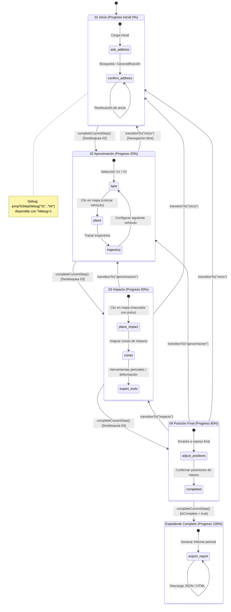

# Documentación Técnica del Proyecto CESVI · Reconstrucción Vial

Proyecto de reconstrucción y peritaje vial interactivo desarrollado con **React 19**, **TypeScript**, **Vite** y **Leaflet**. La aplicación implementa un wizard conversacional guiado de 4 escenas cronológicas para la reconstrucción de hechos de tránsito terrestre.

---

## 1. Arquitectura del Wizard

La arquitectura del sistema está estructurada en capas desacopladas que garantizan inmutabilidad, predictibilidad, persistencia robusta y una única fuente de verdad geográfica.

```
┌────────────────────────────────────────────────────────────────────────┐
│                                App Shell                               │
│           (src/App.tsx · Coordinador de Estado y UI Global)            │
└───────┬────────────────────────────┬───────────────────────────┬───────┘
        │                            │                           │
        ▼                            ▼                           ▼
┌───────────────┐           ┌──────────────────┐        ┌────────────────┐
│   MapCanvas   │           │  AssistantPanel  │        │   DebugPanel   │
│ (Lienzo OSM / │           │        &         │        │ (HUD ?debug=1) │
│   Leaflet)    │           │ WizardController │        │                │
└───────┬───────┘           └────────┬─────────┘        └────────────────┘
        │                            │
        │      ┌─────────────────────┴────────────────────┐
        ▼      ▼                                          ▼
┌─────────────────────────┐                     ┌────────────────────────┐
│   useScenarioItems.ts   │                     │      useWizard.ts      │
│  (Modelo Métrico ENU    │                     │  (Orquestador del      │
│  respecto al Anchor)    │                     │   Flujo y Subestados)  │
└───────────┬─────────────┘                     └───────────┬────────────┘
            │                                               │
            ▼                                               ▼
┌─────────────────────────┐                     ┌────────────────────────┐
│     lib/migration.ts    │                     │  lib/wizardMachine.ts  │
│(Persistencia expediente │                     │(Máquina de Estados FSM │
│ cesvi_expediente_*)     │                     │ Pura, Tipos, Progreso) │
└─────────────────────────┘                     └────────────────────────┘
```

### 1.1 Componentes Principales

| Componente | Ruta | Responsabilidad |
|---|---|---|
| `App` | `src/App.tsx` | Contenedor principal y punto de montaje. Mantiene el ancla geográfica única (`anchor`), coordina el cambio de escenas con el reproductor de timeline (`timeline.selectedFrame`), orquesta los eventos de clic en el mapa y enlaza la retroalimentación visual (toasts). |
| `MapCanvas` | `src/components/map/MapCanvas.tsx` | Visor cartográfico Leaflet. Proyecta las capas de OpenStreetMap, renderiza los vehículos interactivos, el marcador con pulso del punto de impacto, zonas de colisión, evidencias y trayectorias sin recargar el lienzo al cambiar de escena. |
| `AssistantPanel` | `src/components/assistant/AssistantPanel.tsx` | Panel pericial lateral derecho. Aloja la interacción contextual del perito y contiene el controlador paso a paso. |
| `WizardController` | `src/components/wizard/WizardController.tsx` | Renderizador dinámico de los formularios de cada paso (01 Inicio, 02 Aproximación, 03 Impacto, 04 Posición final), gestionando formularios, selección de opciones y botones de avance. |
| `SceneTabs` | `src/components/timeline/SceneTabs.tsx` | Pestañas superiores que representan las 4 escenas cronológicas. Reflejan el bloqueo/desbloqueo de pasos y permiten navegar a escenas previas ya alcanzadas. |
| `CoachMarks` | `src/components/wizard/CoachMarks.tsx` | Banners de bienvenida flotantes no bloqueantes para cada escena. Guían al usuario en su primera visita a cada paso, persisten su descarte en `localStorage` (`cesvi_coachmarks_dismissed`) y respetan la configuración de accesibilidad `prefers-reduced-motion`. |
| `DebugPanel` | `src/components/common/DebugPanel.tsx` | HUD de depuración activo solo con `?debug=1`. Expone coordenadas del ancla, posiciones métricas y geográficas de V1, V2 y evidencias, distancia en metros y botones para saltar a cualquiera de los 4 pasos (01-04) mediante la FSM. |

### 1.2 Hooks de Estado

| Hook | Ruta | Responsabilidad |
|---|---|---|
| `useWizard` | `src/hooks/useWizard.ts` | Expone el estado de la máquina (`wizardState`), progreso porcentual (`progress`), subestados específicos de cada escena (`scene01Substep` a `scene04Substep`), borradores de vehículos (`vehicleDraft`), zonas de colisión y acciones de transición (`goToStep`, `advanceStep`, `jumpToStep`, `restartWizard`). |
| `useScenarioItems` | `src/hooks/useScenarioItems.ts` | Modela y administra vehículos, punto de impacto y evidencias como desplazamientos métricos locales $\{x, y\}$ respecto al ancla única, proyectándolos a WGS84 (`toLatLng`) para su renderizado reactivo. |
| `useLocationSearch` | `src/hooks/useLocationSearch.ts` | Gestiona la geocodificación mediante Nominatim con autocompletado y búsqueda al presionar Enter (`searchAddress`). |
| `useTimelinePlayback` | `src/hooks/useTimelinePlayback.ts` | Administra la línea de tiempo (frames 01 a 04), sincronizando el frame seleccionado con el índice del paso activo del wizard. |

### 1.3 Máquina de Estados Finita (`src/lib/wizardMachine.ts`)

La lógica de control del wizard está desacoplada en un módulo funcional puro, determinista e inmutable:
- **Pasos (`WizardStep`):** `"inicio"`, `"aproximacion"`, `"impacto"`, `"posicion_final"`.
- **Estructura del Estado (`WizardState`):**
  - `step`: Paso activo en el que se encuentra el usuario.
  - `unlockedSteps`: Lista de pasos accesibles (desbloqueados secuencialmente).
  - `completedSteps`: Lista de pasos completados formalmente.
  - `isComplete`: Booleano que indica la culminación total del expediente pericial.
- **Transiciones:**
  - `completeCurrentStep(state)`: Marca el paso actual como completado, desbloquea el siguiente paso y avanza a él. Si se completa `posicion_final`, establece `isComplete: true`.
  - `transitionTo(state, targetStep)`: Permite saltar directamente a cualquier paso previamente desbloqueado sin reiniciar ni perder información.
  - `jumpToStepDebug(state, targetStep)`: Función de desarrollo que desbloquea secuencialmente todos los pasos hasta el paso objetivo y se posiciona en él.
- **Cálculo de Progreso (`calculateProgress`):**
  - Inicio completado: **20%**
  - Aproximación completada: **50%**
  - Impacto completado: **80%**
  - Posición final completada (`isComplete`): **100%**
- **Sanitización (`sanitizeWizardState`):** Valida cualquier objeto recuperado de almacenamiento o API, garantizando que el paso inicial sea válido y que `inicio` esté siempre desbloqueado.

### 1.4 Persistencia

El almacenamiento local se divide en dos claves independientes en `localStorage`:

1. `cesvi_expediente_EXP-0248`:
   - Serializa la versión 2 del expediente (`version: 2`).
   - Almacena el ancla geográfica única (`anchor: { lat, lng }`).
   - Guarda los vehículos modelados como offsets `{x, y}` con rotación, velocidad, tipo y puntos de trayectoria.
   - Guarda el punto de impacto relativo `{x, y}` y evidencias `{label, x, y}`.
   - Guarda el objeto `wizard` (`WizardState`) con el paso actual, pasos completados y desbloqueados.
   - Guarda configuración pericial de impacto (`impactVehicles`, `impactTime`, `impactZones`).

2. `cesvi_coachmarks_dismissed`:
   - Serializa un arreglo JSON de cadenas (`string[]`) con los identificadores de escena que el perito ya descartó con el botón *"Entendido"* (ej. `["inicio", "aproximacion"]`).

---

## 2. Diagrama de Estados y Transiciones del Wizard

El siguiente diagrama modela el ciclo de vida, los subestados de cada escena y las transiciones gobernadas por `wizardMachine.ts`:



---

## 3. Resumen de Fases Implementadas (A - E)

### Fase A: Máquina de Estados, Persistencia y Flujo de Escena 01
- **Commits:** `eca3e96`, `c341433`, `8d2b0df`
- **Implementación:**
  - Creación de la máquina de estados formal `src/lib/wizardMachine.ts` con tipos estrictos, cálculo de porcentaje de avance (0% a 100%), transiciones de avance y salto seguro entre pasos desbloqueados.
  - Batería de pruebas unitarias nativas con `node:test` (`wizardMachine.test.ts`), validando navegación, cálculo de progreso y sanitización de datos corruptos.
  - Adaptación de `src/lib/migration.ts` y tipos en `src/types/scenario.ts` para persistir el objeto `wizard` dentro del expediente `cesvi_expediente_EXP-0248`.
  - Construcción del flujo interactivo de la **Escena 01 (Inicio)**: integración con el buscador de geocodificación (`searchAddress`), recentrado del mapa al confirmar ubicación y desbloqueo progresivo hacia la Escena 02 con 20% de progreso.

### Fase B: Flujo de Escena 02 (Aproximación y Vehículos)
- **Commit:** `4b8909a`
- **Implementación:**
  - Configuración y parametrización de vehículos intervinientes (V1 y V2): tipo de unidad (Automóvil, Camión, Motocicleta), dirección cardinal (N, NE, E, SE, S, SO, O, NO) y velocidad estimada en km/h.
  - Modo interactivo para colocar vehículos en el mapa haciendo clic sobre el carril correspondiente.
  - Trazado dinámico de trayectorias previas al impacto con adición de puntos métricos referenciados al ancla.
  - Avance a la siguiente escena desbloqueando la Escena 03 y actualizando el progreso al 50%.

### Fase C: Flujo de Escena 03 (Punto de Impacto y Zonas)
- **Commit:** `df3f439`
- **Implementación:**
  - Marcador de impacto visual con halo de pulso animado en color rojo (#ef4444) para señalar el punto de contacto primario en la vía.
  - Soporte de arrastre (`draggable`) del punto de impacto para ajustes de alta precisión métrica.
  - Panel pericial para clasificar las zonas de colisión (frontal, lateral derecho, lateral izquierdo, alcance posterior).
  - Incorporación de elementos de inspección pericial (huellas de frenado, dispersión de fragmentos y evidencias E1/E2).
  - Desbloqueo de la Escena 04 con incremento de progreso al 80%.

### Fase D: Flujo de Escena 04 (Posición Final y Exportación)
- **Commit:** `1e8f5b6`
- **Implementación:**
  - Flujo de posicionamiento final en reposo para ambos vehículos tras la pérdida total de energía cinética.
  - Posibilidad de ajustar orientación final (ángulo de rotación) y distancia post-colisión.
  - Botón de finalización que lleva el estado a `isComplete: true` y el progreso al **100%**.
  - Módulo pericial de exportación completa del expediente en formato HTML estructurado y JSON exportable, conteniendo coordenadas geográficas del siniestro, ancla, vehículos, velocidades, trayectorias e indicios.

### Fase E: Usabilidad, Depuración y Documentación Técnica
- **Commits:** `e971115`, `86e2af2`, commit actual
- **Implementación:**
  - **Coach Marks contextuales (`CoachMarks.tsx`):**
    - Guías de bienvenida al ingresar por primera vez a cada escena (01 a 04).
    - Persistencia de estados descartados en `localStorage` bajo `cesvi_coachmarks_dismissed`.
    - Botón de confirmación *"Entendido"* con descarte inmediato.
    - Diseño flotante sin backdrop que evita bloquear clics o arrastres en el mapa.
    - Soporte completo para accesibilidad con `prefers-reduced-motion: reduce` (supresión de transiciones y pulso).
  - **Herramientas de Depuración (`DebugPanel.tsx`):**
    - Visualización del HUD solo cuando la URL contiene `?debug=1`.
    - Inclusión de botones *"Saltar a paso 01"*, *"Saltar a paso 02"*, *"Saltar a paso 03"* y *"Saltar a paso 04"*.
    - Reutilización directa de la transición `jumpToStepDebug` de `wizardMachine.ts` sin duplicación de lógica.
    - Sincronización inmediata con el frame del timeline y feedback visual mediante toast.
  - **Documentación Técnica Integral (`CAMBIOS.md`):**
    - Arquitectura exhaustiva del wizard, componentes, hooks y persistencia.
    - Diagrama Mermaid de estados, subestados y transiciones.
    - Resumen cronológico de las Fases A hasta la E.
